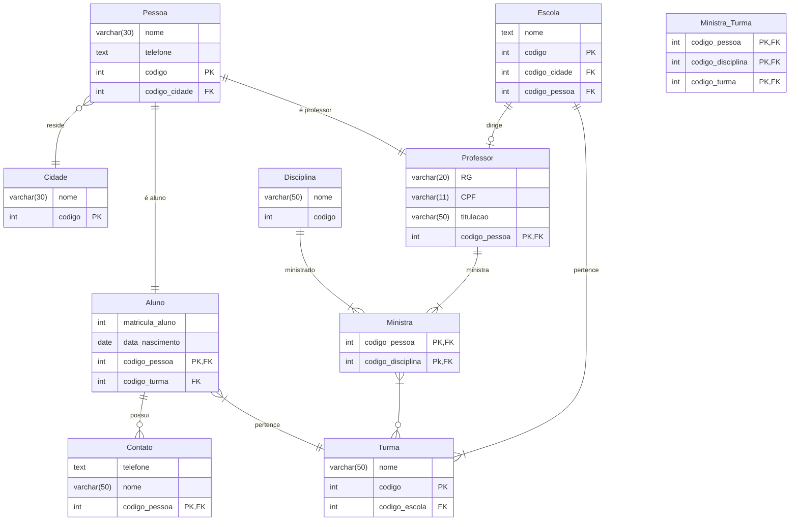

Tentando resolver um problema no quarto
```quarto
```{r, echo=FALSE, message=FALSE, warning=FALSE}
library(DiagrammeR)
library(DiagrammeRsvg)
library(rsvg)

# Cria o diagrama de entidade-relacionamento
meu_diagrama <- mermaid("
erDiagram
    EMENTAS ||--|| DISCIPLINAS : associa
")

# Salva automaticamente como PNG na sua pasta
export_svg(meu_diagrama) %>% 
  charToRaw() %>% 
  rsvg_png("diagrama_er.png")
```
Enfim, decidi que vou só tirar print do mermaid live mesmo. Como ficaria o modelo lógico da escola?


Ok, o mermaid do [[Projeto_Logico_Colega.jpg]]:

Eu acho absolutamente incrível como esses join's funcionam! Como que isso acontece internamente?! Por que eu não tive que fazer algo tipo:
```
select 
 ... atributos ...
 from tabela_1
 left join tabela_2 on tabela_1.att = tabela_2.att
   select 
   ... atributos dessa nova tabela cruzada ...
   from tabela_cruzada
   left join tabela_3 on tabela_cruzada.att = tabela_3.att
    ...
```

Os diagramas mermaid são vetoriais, certo? em qual formato é pra salvar eles, csv?