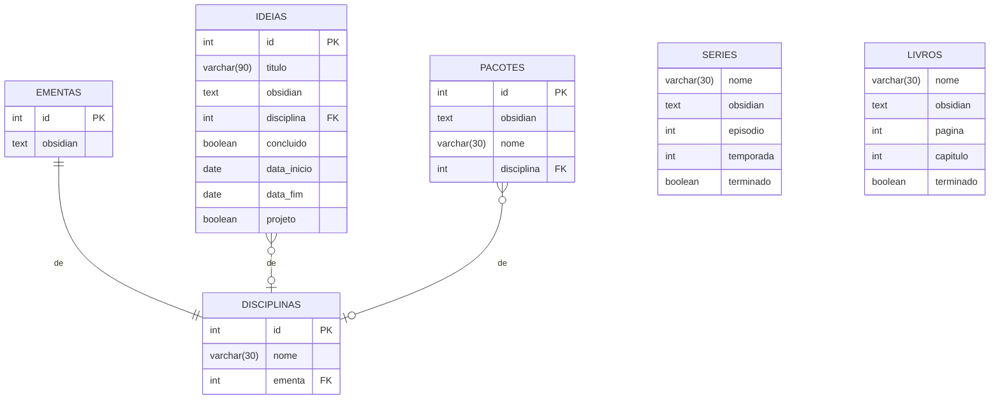

Uma coisa que vai facilitar muito é: antes eu pensava em criar autorrelacionamento para mostrar quais ideias se relacionavam entre si, mas percebi que posso simplesmente deixar tudo no Obsidian mesmo e criar só a tabela em sql, pois no próprio obsidian já posso criar os links.


Perceba que Pacotes vem do meu outro projeto [[Catalogação de Pacotes e Funções R]]
"Na tabela filha, essa coluna assume um papel duplo: ela é **simultaneamente a Chave Primária (PK) e a Chave Estrangeira (FK)**." mas tem diferença se eu colocar como chave primária da tabela filha e como FK e chave primária na tabela pai? Por que eu acho que isso facilitaria de alguma forma, além disso, eu gostaria que ao criar na tabela filha um atributo ele fosse criado automaticamente na tabela pai.
Ok, agora imagina que eu criei a tabela Projetos e ela é uma especialização da tabela Ideias. Como eu faço para que as colunas que já estavam preenchidas em Ideias se preencham automaticamente em Projetos só de colocar o id referenciando a tabela?

Eu estou evitando criar relações "muitos para muitos" já que vai estar tudo documentado no obsidian mesmo, pra ficar mais simples também, por exemplo, uma ideia na teoria poderia estar relacionadas a várias disciplinas, mas eu escolhi deixar cada ideia relacionada à 1 disciplina pra não ter que criar outra tabela...

### Entidades candidatas
#### Desenho
Inspirações de desenho
#### Obras
Obras para pensar sobre, tipo livros
#### Autores
Lista de autores
#### Séries
Séries para ver ou que estou vendo
#### Ideias
Ideias que eu tive e quero estudar
#### Aulas
Documentação das aulas
#### Listas de questões
Documentação das listas de questões
#### Ementa de disciplina
Assuntos da ementa da disciplina 
#### Eventos
Eventos pra ir, especialmente os de sexta-feira

```
library(DBI)
library(RPostgres)

# 1. Estabelece a conexão com o banco
con <- dbConnect(
  RPostgres::Postgres(),
  dbname   = "nome_do_seu_banco",
  host     = "localhost",
  port     = 5432,
  user     = "postgres",
  password = "sua_senha"
)

# 2. Lê a tabela inteira do PostgreSQL para um data frame do R
minha_tabela <- dbReadTable(con, "ideias") # substitua pelo nome da sua tabela
```
![[Pasted image 20261008052254.png|427]]
```
library(DBI)
library(RPostgres)
con <- dbConnect(
  RPostgres::Postgres(),
  dbname   = "postgres",
  host     = "localhost",
  port     = 5432,
  user     = "postgres",
  password = "newkitty"
)
minha_tabela <- dbReadTable(con, "provas") 
```
Legal, agora eu sei como botar isso no R. Mas teria como colocar minhas tabelas no Obsidian de modo que elas se atualizem automaticamente quando eu fizer alterações no sql?

```sql
SELECT * FROM vw_provas;
```
Ok, funcionou, achei muito legal. Mas como que eu deixo a tabela já salva aqui e formatada em markdown? Daí eu quero que ela se atualize automaticamente.... Enfim.

Muitas vezes fica incerto se eu vou usar ou não certas coisas que eu modelo no DER... Sabe por que? É que eu sinto que eu tenho muitos interesses que não são botados em prática, que eu procrastino ou não sei como começar, porém eu gostaria de começar a me organizar no obsidian.
Tem livros que eu quero ler
Tem maquiagens que eu quero fazer
Tem séries que eu quero ver
Tem filosofias que eu quero aprofundar
Tem projetos e ideias que eu quero colocar em prática
E mesmo assim a sensação é de: e se eu não tiver motivação pra nada disso? E se eu não usar nada disso? Enfim, eu queria mesmo usar essas coisas, tanto que eu me interesso por psicologia comportamental e sei que criar uma função no R que me recomende certas consultas em sql poderia ser benéfico pra mim. Eu tenho gatilhos, obsessões, dias de muita tristeza em que eu queria pelo menos fazer uma coisa útil sem qualquer energia disponível, mas tenho medo de me paralisar diante de tantas ocorrências em tabelas.

Me pergunto se é possível que o R faça consultas inteligentes pra mim, do tipo, se eu estiver me preparando pra estudar pra faculdade, que ele consulte a tabela de datas de provas, veja as provas mais próximas e automaticamente recomende as aulas da tabela de aulas da respectiva matéria. Mas ao mesmo tempo parece trabalhoso demais e até inútil... Se algo mudar no sistema ou nas tabelas terei que ficar alterando a função por exemplo

Como fazer cruzamento de dados em postgresql? Por exemplo, quero cruzar as tabelas aulas e disciplinas
```sql
select aulas.data, aulas.prova, disciplinas.nome
from aulas
inner join disciplinas on  aulas.disciplina_id=disciplinas.id;
```
```sql
insert into aulas (data,disciplina_id,prova,visto)
values ('2026-10-08',2,2,false);
```
```sql
select * from aulas;
```
```sql
update aulas
set visto=false where visto is null;
```
```sql
delete from aulas
where prova=1 or disciplina_id in (2);
```
```sql
select * from diario_estudo;
```
```sql
update diario_estudo 
set minutos=54 where dia=current_date;
```
Uma das coisas que eu aprendi é que eu posso relacionar a tabela EMENTAS com IDEIAS contanto que ambas estejam relacionadas com a tabela DISCIPLINAS, certo? Mesmo que não tenha ligação direta entre EMENTAS e IDEIAS.

Tô na seguinte situação: não sei como criar os pacotes no R, eu tenho funções que atendem à diferentes matérias mas que são muito correlacionadas entre si... Como conseguir criar e organizar pacotes com roxygen2 assim?

